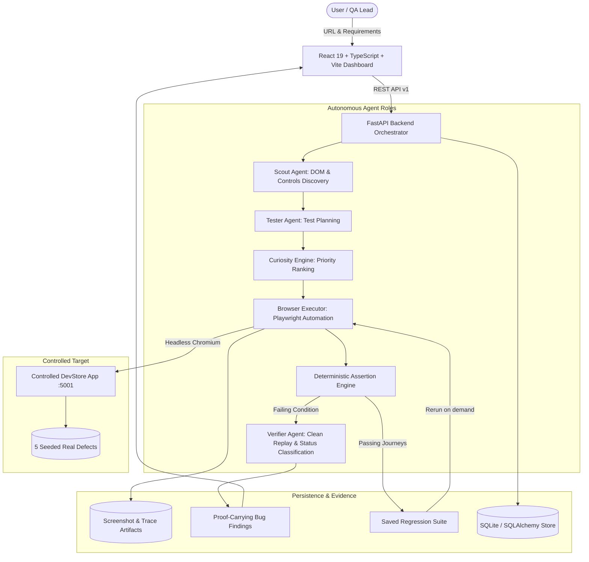

# Autonomous AI QA Engineer
### iMocha Track | Problem Statement IM-02

> **"Explore &rarr; Understand &rarr; Plan &rarr; Execute &rarr; Verify &rarr; Report &rarr; Learn"**

An autonomous, agentic software testing platform that explores web applications like an expert human QA engineer, decides what to test using an explainable **Curiosity Engine**, executes browser journeys through Playwright automation, verifies defects with deterministic replays, produces **proof-carrying bug reports**, and transforms successful journeys into **reusable regression suites**.

---

## Architecture Overview



---

## Core Differentiators

1. **Curiosity Engine:** Prioritizes what to test next based on a normalized, explainable formula:
   $$\text{Priority} = w_{\text{impact}} \cdot \text{Impact} + w_{\text{uncertainty}} \cdot \text{Uncertainty} + w_{\text{novelty}} \cdot \text{Novelty} + w_{\text{coverage}} \cdot \text{Coverage Gap} - \text{Cost Penalty}$$
   Every decision includes human-readable rationale (e.g. *"Cart quantity was prioritized because it touches high-impact revenue workflows and closes an untested coverage gap"*).
2. **Proof-Carrying Bug Reports:** Findings are not mere assertions; every report provides step-by-step reproduction instructions, side-by-side expected vs. actual behavior, clean-session replay verification, browser console errors, and full-resolution screenshot evidence.
3. **Specialized QA Roles:**
   - **Scout Agent:** Inspects DOM trees, accessibility roles, buttons, inputs, and builds navigation topology.
   - **Tester Agent:** Consumes natural-language descriptions, plans test cases, and evaluates risk boundaries.
   - **Verifier Agent:** Isolates suspicious failures, replays journeys in clean contexts, and classifies findings into `Confirmed`, `Suspected`, `Inconclusive`, or `Not Reproducible`.
4. **Resilient Locators:** Automatically falls back to semantic attributes, labels, accessibility roles, and visible text when CSS selectors change.
5. **Reusable Regression Testing:** Passing journeys can be saved with one click and rerun against new application builds to detect regressions or verify fixes.
6. **Dual Engine Modes:**
   - **Deterministic Demo Mode:** Fully functional out-of-the-box without requiring external API keys.
   - **Real AI Mode:** Integrates with Google Gemini, OpenAI, or Anthropic for LLM-driven reasoning with strict Pydantic schema validation.

---

## Controlled Sample E-Commerce Application

A complete e-commerce store (**DevStore**) is included in `sample_app/` running on `http://127.0.0.1:5001`. It features catalog browsing, cart management, checkout forms, registration, login, and user profile management, with **5 documented, deliberately planted defects**:

| Bug ID | Location | Planted Vulnerability / Defect | Expected Behavior | Actual Observed Defect |
| :--- | :--- | :--- | :--- | :--- |
| **BUG-01** | `/register` | Faulty Email Validation | Rejects invalid emails without `@` or domain | Naively accepts `invalid_user_without_at` |
| **BUG-02** | `/cart` | Calculation Arithmetic Desync | Recalculates subtotal on quantity increment | Subtotal display fails to update |
| **BUG-03** | `/checkout` | Missing Postal Code Validation | Enforces required Postal/ZIP code field | Allows empty postal code to place order |
| **BUG-04** | `/checkout` | Non-Idempotent Duplicate Order | Prevents rapid double-click submissions | Creates duplicate orders with separate IDs |
| **BUG-05** | `/account` | Broken Access Control | Redirects unauthenticated visits to `/login` | Serves customer profile to anonymous visits |

*Reset demo state anytime via `POST /api/reset` or `python scripts/reset_demo.py`.*

---

## Technology Stack

### Frontend
- **Framework:** React 19, TypeScript, Vite
- **Styling:** Tailwind CSS v4, Custom Emerald/Charcoal Design Tokens
- **Routing:** React Router v7
- **Visualization:** Recharts (pie charts, bar charts, metrics)
- **Icons:** Lucide React
- **HTTP Client:** Axios

### Backend
- **Framework:** FastAPI, Python 3.12, Uvicorn
- **Browser Automation:** Playwright for Python (Chromium)
- **Database:** SQLAlchemy 2.0, SQLite (persistent file `apex_qa.db`)
- **Validation:** Pydantic v2, Pydantic-Settings
- **Testing:** Pytest, Pytest-Asyncio
- **Templating:** Jinja2 (Sample App)

---

## Repository Structure

```
CODEAPEX/
├── backend/
│   ├── app/
│   │   ├── main.py                  # FastAPI application entry point
│   │   ├── core/                    # Config, security, SSRF boundaries
│   │   ├── db/                      # SQLAlchemy models & SQLite session
│   │   ├── schemas/                 # Pydantic schemas (plans, assertions, bugs)
│   │   ├── services/
│   │   │   ├── run_controller.py    # Central orchestrator & state machine
│   │   │   ├── browser_manager.py   # Playwright session & screenshot capture
│   │   │   ├── browser_executor.py  # Action executor & resilient locators
│   │   │   ├── curiosity_engine.py  # Prioritization & explainability scoring
│   │   │   ├── assertions.py        # Deterministic assertion engine
│   │   │   └── report_builder.py    # Proof-carrying HTML/JSON generator
│   │   ├── agents/
│   │   │   ├── scout.py             # Scout agent (DOM inspection)
│   │   │   ├── tester.py            # Tester agent (planning & curiosity)
│   │   │   └── verifier_agent.py    # Verifier agent (replay & classification)
│   │   └── api/v1/router.py         # Version 1 REST API routes
│   ├── requirements.txt             # Python dependencies
│   └── tests/                       # Automated unit & E2E tests
├── frontend/
│   ├── src/
│   │   ├── api/client.ts            # API client with full TypeScript types
│   │   ├── components/layout/       # Sidebar, Topbar, Layout
│   │   ├── pages/
│   │   │   ├── Dashboard.tsx        # Overview KPI cards & chart metrics
│   │   │   ├── NewRun.tsx           # Test run creation form
│   │   │   ├── Exploration.tsx      # Discovered pages & interactive site map
│   │   │   ├── TestRuns.tsx         # Test execution console & step inspector
│   │   │   ├── BugReports.tsx       # Filterable defect list
│   │   │   ├── BugDetail.tsx        # Proof-carrying defect detail view
│   │   │   ├── RegressionTests.tsx  # Saved regression suite & rerun diffs
│   │   │   └── Settings.tsx         # AI provider & security status
│   │   ├── App.tsx                  # Main router definition
│   │   └── index.css                # Emerald design tokens & Tailwind styles
│   └── package.json
├── sample_app/
│   ├── main.py                      # Controlled e-commerce store with 5 bugs
│   ├── templates/                   # Semantic HTML templates
│   ├── static/style.css             # Store styling
│   └── SEEDED_DEFECTS.md            # Detailed defect catalog
├── artifacts/                       # Screenshot and export storage
├── scripts/
│   ├── run_demo.py                  # Unified one-command startup runner
│   ├── reset_demo.py                # Script to reset demo application state
│   ├── setup.ps1                    # PowerShell setup script for Windows
│   └── setup.sh                     # Bash setup script for Linux/macOS
├── .env.example                     # Environment template
└── README.md                        # Documentation
```

---

## Quickstart & Installation

### Prerequisites
- Python 3.11+ (Python 3.12 recommended)
- Node.js v18+ and npm
- Git

### 1. Automated Setup (Recommended)

#### On Windows (PowerShell):
```powershell
.\scripts\setup.ps1
```

#### On Linux / macOS (Bash):
```bash
chmod +x scripts/setup.sh
./scripts/setup.sh
```

---

### 2. Manual Step-by-Step Setup

#### Backend Setup:
```powershell
# Create and activate virtual environment
python -m venv backend\venv
.\backend\venv\Scripts\Activate.ps1

# Install requirements
pip install -r backend\requirements.txt

# Install Playwright browser binaries
playwright install chromium
```

#### Frontend Setup:
```powershell
cd frontend
npm install
npm run build
cd ..
```

---

## Running the Application

### Option A: Unified One-Command Runner (Easiest)
Launches the Sample Store, Backend API, and Frontend concurrently:
```powershell
.\backend\venv\Scripts\python.exe scripts\run_demo.py
```

### Option B: Running Services Individually

1. **Terminal 1 — Controlled Sample App:**
   ```powershell
   .\backend\venv\Scripts\python.exe -m uvicorn sample_app.main:app --host 127.0.0.1 --port 5001
   ```
2. **Terminal 2 — FastAPI Autonomous QA Backend:**
   ```powershell
   .\backend\venv\Scripts\python.exe -m uvicorn backend.app.main:app --host 127.0.0.1 --port 8000
   ```
3. **Terminal 3 — React Frontend:**
   ```powershell
   cd frontend
   npm run dev
   ```

Open your browser to:
- **Frontend Dashboard:** [http://localhost:5173](http://localhost:5173)
- **Backend Swagger Docs:** [http://127.0.0.1:8000/docs](http://127.0.0.1:8000/docs)
- **Sample Store Target:** [http://127.0.0.1:5001](http://127.0.0.1:5001)

---

## Running Automated Tests

Run unit tests and full autonomous browser E2E tests:

```powershell
# Run core unit tests
.\backend\venv\Scripts\python.exe -m pytest backend\tests\test_core.py -v

# Run full end-to-end autonomous QA test (executes Playwright against live sample app)
.\backend\venv\Scripts\python.exe -m pytest backend\tests\test_e2e.py -v -s
```

---

## Configuration & Modes

Configure your environment in `.env` (copied from `.env.example`):

### Deterministic Demo Mode (Default)
```env
LLM_PROVIDER=demo
DATABASE_URL=sqlite:///./apex_qa.db
FRONTEND_ORIGIN=http://localhost:5173
```
No API key required. Executes genuine Playwright browser automation with structured test cases calibrated to test the sample app's features and detect planted defects.

### Real AI Mode (Google Gemini / OpenAI)
```env
LLM_PROVIDER=gemini
LLM_MODEL=gemini-2.5-flash
LLM_API_KEY=your_gemini_api_key_here
```
When configured, the Tester Agent queries the model to synthesize structured test cases, validated against Pydantic schemas.

---

## Security & Responsible Testing

- **SSRF Mitigation & Allowed Hosts:** The backend strictly rejects target URLs outside whitelisted domains (`127.0.0.1`, `localhost`, `devstore.local`). Cloud metadata IP `169.254.169.254` is blocked.
- **Sensitive Data Redaction:** Passwords, tokens, and authorization headers are automatically scrubbed from logs and prompts using regex sanitization filters.
- **Controlled Action Sandbox:** Only validated Playwright actions (`goto`, `click`, `fill`, `select`, `wait`, `screenshot`) can be performed. Arbitrary shell commands or unsanitized JavaScript evaluations are rejected.
- **Bounded Budgets:** Run controller enforces strict execution time limits, maximum action caps, and exploration page limits.

---

---

## Demonstration Guide (5 Minutes for Hackathon Judges)

1. **Launch Run:** Navigate to **New Test Run** (`http://localhost:5173/new-run`). The sample app URL `http://127.0.0.1:5001` is pre-populated with exploratory objectives. Click **"Start Autonomous Test Run"**.
2. **Observe Exploration:** The system opens the **Explore Application** page. Watch the Scout Agent discover the navigation links and interactive controls across multiple routes in real time.
3. **Inspect Plan & Execution:** Navigate to **Test Runs**. Observe candidate tests prioritized by the **Curiosity Engine**. Click each test to view numbered steps, assertions, and captured screenshots.
4. **Inspect Bug Reports & Proof:** Navigate to **Bug Reports**. Review verified findings (e.g. `BUG-01` email validation, `BUG-02` cart arithmetic desync, `BUG-03` postal validation, `BUG-04` double-submit idempotency, `BUG-05` unauthenticated access). Inspect side-by-side expected vs actual behavior and captured failure screenshot. Click **"Export Markdown"** or **"Export HTML"** to download the proof-carrying report.
5. **Inspect Benchmark Console & Ground Truth:** Navigate to **Benchmark Console** (`/benchmark`). Review the isolated ground-truth defect comparison matrix, Defect Recall (%), Precision (%), Reproducibility Rate (%), and Journey Coverage (%).
6. **Toggle Planted Defects & Prove Regression Memory:**
   - In the Benchmark Console, click **"Toggle"** on any defect (e.g. `BUG-01` or `BUG-02`) to simulate a software fix or a regression.
   - Navigate to **Regression Tests** (`/regression`). Click **"Run Entire Suite"** to execute all saved journeys concurrently in clean browser contexts.
   - Observe the diff analyzer flagging newly passed fixes or newly introduced regressions with clear before/after diffs!
7. **Export JUnit XML for CI/CD:** Export test results via `/api/v1/runs/{run_id}/export?format=junit` for direct CI/CD integration.

---

## License

Developed for **iMocha Track | Problem Statement IM-02**.
All synthetic data and demonstration targets are for local verification only.
